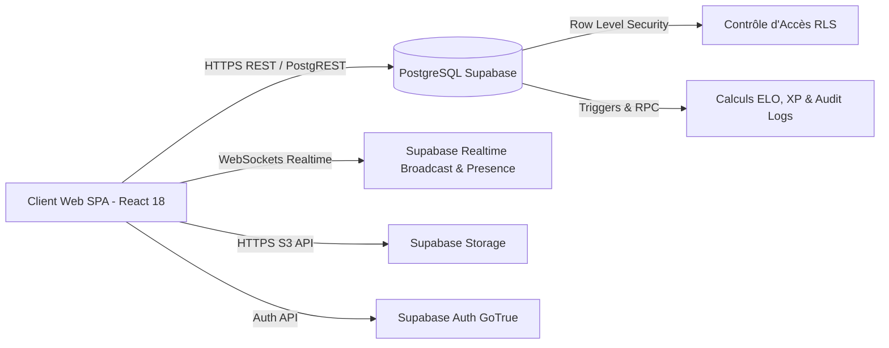

# 02 — Architecture Technique & Flux Système

## 1. Vue d'Ensemble Logique

**TerraCoast** fonctionne comme une Single Page Application (SPA) sans serveur applicatif Node.js/Express intermédiaire. Toute la logique serveur est déléguée aux primitives managées de **Supabase** :

---

## 2. Découpage du Frontend & Routage

L'application utilise **React Router DOM v6** avec un découpage dynamique par paquets (`code-splitting`) via un utilitaire de chargement résilient [`lazyWithRetry.ts`](file:///Users/fullann/Documents/GitHub/TerraCoast/src/lib/lazyWithRetry.ts) pour garantir une navigation instantanée et la tolérance aux pannes réseau ou redéploiements.

### Routes Majeures de l'Application

| Route | Composant | Description |
|---|---|---|
| `/` | `LandingPage` / `HomePage` | Accueil public si non-connecté, tableau de bord joueur et globe d'exploration si authentifié |
| `/login`, `/register` | `LoginForm`, `RegisterForm` | Authentification encapsulée dans `AuthLayout` (DA tactile) |
| `/conquest` | `ConquestPage` | Pokédex Géographique & Conquête Mondiale (carte Fog of War, cartes TCG holographiques, album) |
| `/cards` | `TerraDexPage` | Album TerraDex des cartes de pays à collectionner et ouverture animée de boosters |
| `/duels` | `DuelsPage` | Arène 1v1, matchmaking radar, gestion des tours de jeu et Ghost Runs |
| `/party` | `PartyPage` | Salons multijoueurs façon Kahoot (lobby, écran hôte, live game, podium) |
| `/atlas` | `AtlasPage` | Planisphère 2D, globe 3D, recherche prédictive, micro-états, fiches pays et comparateur TrueSize |
| `/radio-globe` | `RadioGlobePage` | Globe 3D des webradios mondiales géolocalisées en streaming direct |
| `/friends` | `FriendsPage` | Gestion de la liste d'amis, demandes d'amitié, statuts en ligne et défis |
| `/chat/:friendId` | `ChatPage` | Messagerie instantanée sécurisée entre amis avec retour direct vers `/friends` |
| `/settings` | `SettingsPage` | Paramètres du compte, mot de passe, 2FA TOTP, langue et zone de danger |
| `/games` | `GamesHubPage` | Hub des 11 mini-jeux géographiques dédiés avec records personnels unifiés |
| `/games/*` | Pages jeux spécifiques | Geo Detective, Chrono Rush, Silhouette, Higher/Lower, Map Blitz, Physical Geo, Travle, Border Puzzle, TimeGuessr, City Guesser, SRS |
| `/quizzes` | `QuizzesPage` | Catalogue communautaire des quiz avec filtres et recherche |
| `/quizzes/create`, `/edit/:id` | `CreateQuizPage`, `EditQuizPage` | Éditeur visuel complet de quiz |
| `/quizzes/play/:id` | `PlayQuizPage` | Moteur d'exécution des questions (QCM, texte, puzzle, Top 10, multi-champs) |
| `/training` | `TrainingModePage` | Mode entraînement zen sans chronomètre |
| `/shop` | `ShopPage` | Boutique de cosmétiques (cadres d'avatar, thèmes de globe, boosters) |
| `/leaderboard` | `LeaderboardPage` | Classements mensuels, ligues compétitives et podiums |
| `/admin/*` | `AdminDashboardLayout` | Console d'administration v2.4 (Hub 18 modules, Geo Detective photos, cartes TerraDex, site_config en direct, analytics, audit) |

---

## 3. Gestion du Layout & Mode Plein Écran Dynamique

Pour offrir une immersion optimale et éliminer les en-têtes redondants (*double-headers* sur mobile et tablette) :
- Le composant gardien [`ProtectedRoute.tsx`](file:///Users/fullann/Documents/GitHub/TerraCoast/src/components/auth/ProtectedRoute.tsx) inspecte le chemin actif (`location.pathname`).
- La Navbar globale utilisateur est automatiquement masquée sur :
  1. Les **sessions de mini-jeux actives** (`/games/:gameId`), laissant l'intégralité de l'écran aux HUDs in-game (boutons quitter, minuteries, jauges de combos).
  2. Les **sessions de quiz et compétitions** (`/quizzes/play`, `/duels/play`, `/party`).
  3. La **console d'administration** (`/admin/*`), évitant le doublon entre la Navbar joueur et la barre de commande exécutive sombre de l'administration.
- La Navbar reste présente sur les hubs de découverte (`/games`, `/quizzes/training`, `/atlas`, `/conquest`, etc.).

---

## 4. Architecture de Configuration Dynamique (`site_config`) & Cartes (`terra_cards`)

L'application est 100% administrable en direct sans redéploiement grâce à une architecture hybride Cache Local + Supabase :
1. **Sauvegarde Bidirectionnelle** :
   - Dès qu'un administrateur modifie le Pays de la Semaine, la bannière d'annonce ou les multiplicateurs Double XP dans [`SiteConfigPage.tsx`](file:///Users/fullann/Documents/GitHub/TerraCoast/src/components/admin/SiteConfigPage.tsx), les modifications sont appliquées localement et propagées sur la table Supabase `site_config`.
   - Idem pour la création de cartes dans [`CardsManagementPage.tsx`](file:///Users/fullann/Documents/GitHub/TerraCoast/src/components/admin/CardsManagementPage.tsx) sur la table `terra_cards`.
2. **Synchronisation au Démarrage** :
   - Au lancement de l'application, [`App.tsx`](file:///Users/fullann/Documents/GitHub/TerraCoast/src/App.tsx) appelle `syncSiteConfigFromSupabase()` et `syncCardsCatalogFromSupabase()` en tâche de fond.
   - Tous les visiteurs reçoivent immédiatement la configuration et les cartes actives.
3. **Résilience Hors-Ligne** :
   - En cas d'indisponibilité réseau, l'application bascule silencieusement sur le cache `localStorage` et les catalogues locaux intégrés.

---

## 5. Architecture Multijoueur Temps Réel (Mode Party)

Le mode multijoueur (`/party`) repose sur les canaux temps réel de Supabase :

1. **Présence des Joueurs (`Presence Channel`)** :
   - Chaque participant s'inscrit au canal `party:{roomCode}` avec son pseudo et son avatar.
   - L'hôte reçoit les notifications d'arrivée et de déconnexion en direct pour animer la salle d'attente.
2. **Diffusion d'Événements (`Broadcast Events`)** :
   - `START_GAME` : transmission de l'état de démarrage par l'hôte.
   - `NEW_QUESTION` : envoi de la question actuelle et du compte à rebours synchronisé.
   - `SUBMIT_ANSWER` : envoi chiffré des réponses des participants.
   - `ROUND_REVEAL` : révélation des résultats et du classement intermédiaire.
   - `FINAL_PODIUM` : affichage du podium final et déclenchement des confettis.
3. **Mode Hôte Écran Seul** :
   - L'état de l'hôte possède un drapeau `isSpectatorOnly = true`.
   - Il diffuse les questions et orchestre le jeu sans être enregistré dans la liste des scores participants, idéal pour projeter sur rétroprojecteur de classe ou écran de salon.

---

## 6. Moteur Audio & Retour Haptique

Pour éviter les temps de chargement et le poids des fichiers audio externes :
- **Synthétiseur Web Audio API natif** (`src/lib/soundManager.ts`) :
  - Génération algorithmique d'ondes sinusoïdales et de filtres harmoniques.
  - Tonalités pour les bonnes réponses (arpège ascendant majeur), mauvaises réponses (accord dissonant amorti), tic-tac d'urgence et fanfare de victoire.
- **Support Haptique** :
  - Déclenchement de micro-vibrations sur appareils compatibles (`navigator.vibrate`) pour un feedback tactile physique immédiat.

---

## 7. Gestion des Données, Sécurité & Caches

1. **Row Level Security (RLS)** :
   - Chaque table PostgreSQL possède des règles strictes `USING` et `WITH CHECK`.
   - Déclencheur `enforce_profiles_self_update_guard()` empêchant toute modification illicite des rôles, XP ou statuts.
   - Table `site_config` et `terra_cards` protégées en écriture pour les seuls administrateurs.
2. **Fonctions RPC SQL Sécurisées** :
   - `grant_arcade_rewards()` : attribution atomique et bornée (max 1000 XP) avec verrou `FOR UPDATE` pour les 11 mini-jeux et missions.
   - `log_admin_event()` : journalisation administrative inviolable.
3. **En-têtes HTTP de Sécurité (OWASP)** :
   - En-têtes `X-Frame-Options: SAMEORIGIN`, `X-Content-Type-Options: nosniff`, `Referrer-Policy: strict-origin-when-cross-origin` et `Permissions-Policy` configurés dans `.htaccess` et `_headers`.
4. **Stratégie de Cache PWA (Workbox)** :
   - `CacheFirst` pour les chunks JS hashés immuables, les fichiers GeoJSON CDN et les polices Google Fonts.
   - `StaleWhileRevalidate` pour les images du stockage Supabase.
   - `no-cache` pour `index.html` et `sw.js` afin de garantir les mises à jour instantanées.
