# TerraCoast 🌍

*Apprends la géographie de manière ludique, sociale et gratuite.*

<p align="center">
  
</p>

<p align="center">
  <a href="https://TerraCoast.ch"></a>
  <a href="https://dev.terracoast.ch"></a>
  
  
</p>

---

## 📖 À propos

**TerraCoast** est une plateforme web interactive et communautaire dédiée à l'apprentissage de la géographie par le jeu. Conçue avec les meilleures mécaniques de gamification (ergonomie tactile style Duolingo, compétitions en direct façon Kahoot, défis quotidiens, collection de cartes holographiques TCG et exploration cartographique 2D/3D), elle s'adresse aux élèves, étudiants, passionnés et curieux du monde entier.

Le projet est une **SPA React moderne** connectée à **Supabase** (PostgreSQL, Row Level Security, RPC atomiques, Realtime et Storage). La logique métier et la sécurité reposent sur des fonctions SQL isolées, des canaux de présence en temps réel et des règles RLS certifiées.

---

## 📸 Aperçu de l'Application

### 🚀 1. Page d'Accueil & Vitrine TerraCoast 2.0
> *Présentation moderne, aperçu de cartes holographiques, sélection de calques 3D, bannières d'annonces mondiales et Radio Globe intégrée.*

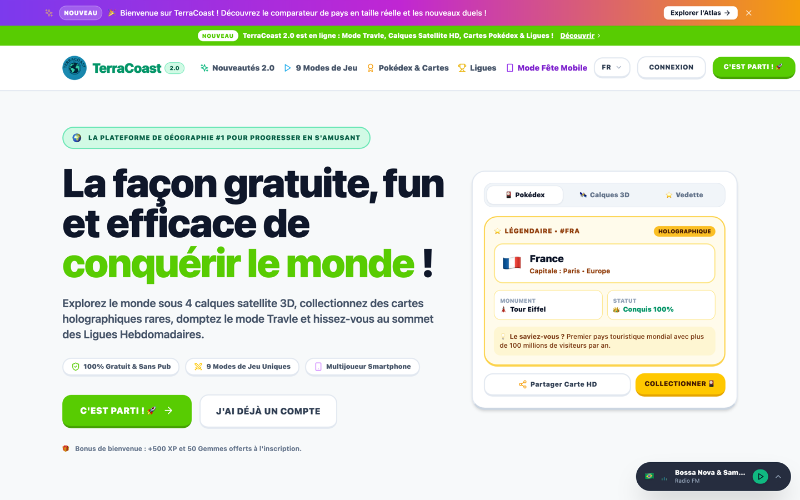

---

### 🗺️ 2. Atlas Mondial Interactif & TrueSize
> *Exploration 2D vectorielle et Globe 3D avec comparateur de superficie réelle TrueSize, recherche prédictive et pastilles pour micro-états.*

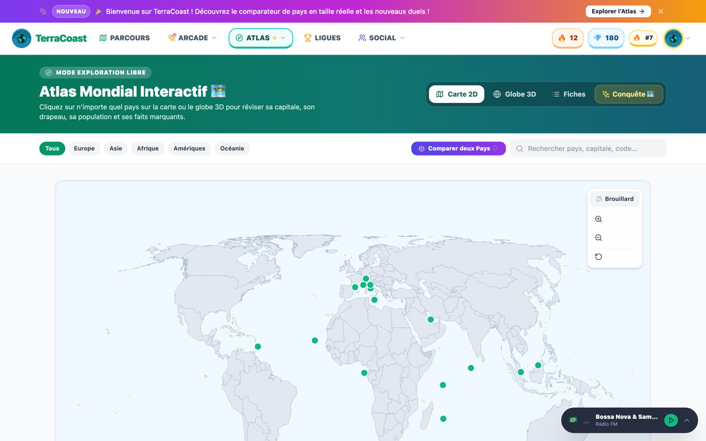

---

### 🌟 3. Pokédex Géographique & Conquête Mondiale
> *Brouillard de guerre interactif : chaque pays validé s'illumine sur la mappemonde sombre et débloque sa carte holographique d'explorateur.*

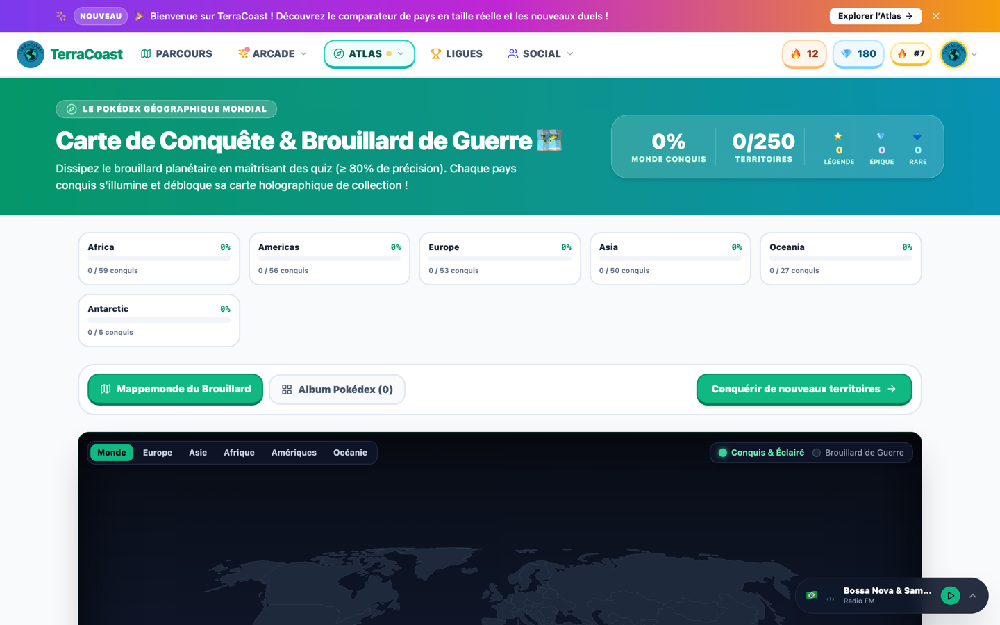

---

### 🗺️ 4. Parcours d'Apprentissage & Quêtes Pas à Pas
> *Arbre de compétences façon Duolingo, étoiles de maîtrise, pays vedette de la semaine avec capsule audio et missions quotidiennes.*

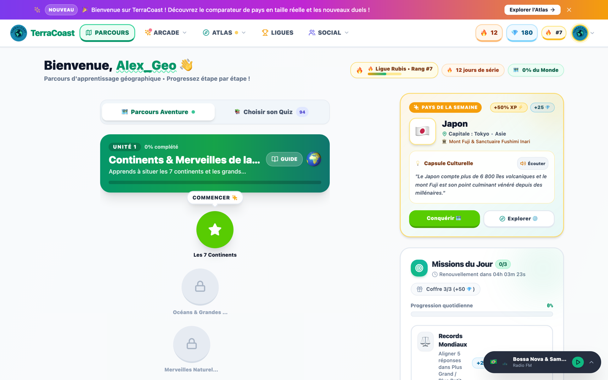

---

### 🎮 5. Salle d'Arcade : Hub des 11 Modes de Jeu
> *Geo-Detective Satellite, Silhouette Mystère, Chrono Rush, Plus Grand / Plus Petit, Travle, Map Blitz, Physical Geo et missions du jour.*

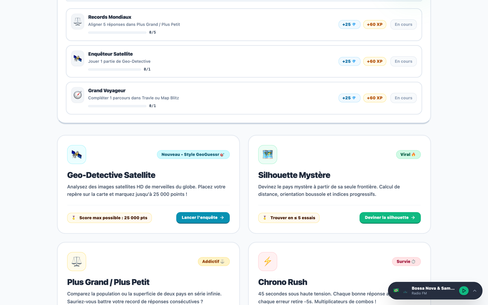

---

### 🧭 6. Mode Travle (Voyage de Pays en Pays)
> *Ralliez deux pays en traversant le moins de frontières possible grâce à l'algorithme BFS. Modes Défi du Jour et Voyages Libres.*

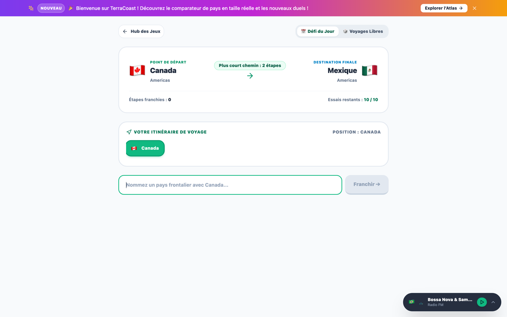

---

### 🎴 7. Le TerraDex & Comptoir des Boosters
> *Collection de cartes d'art holographiques 3D (60 cartes uniques, 5 raretés), déballage de boosters quotidiens et forge de poussières d'étoile.*

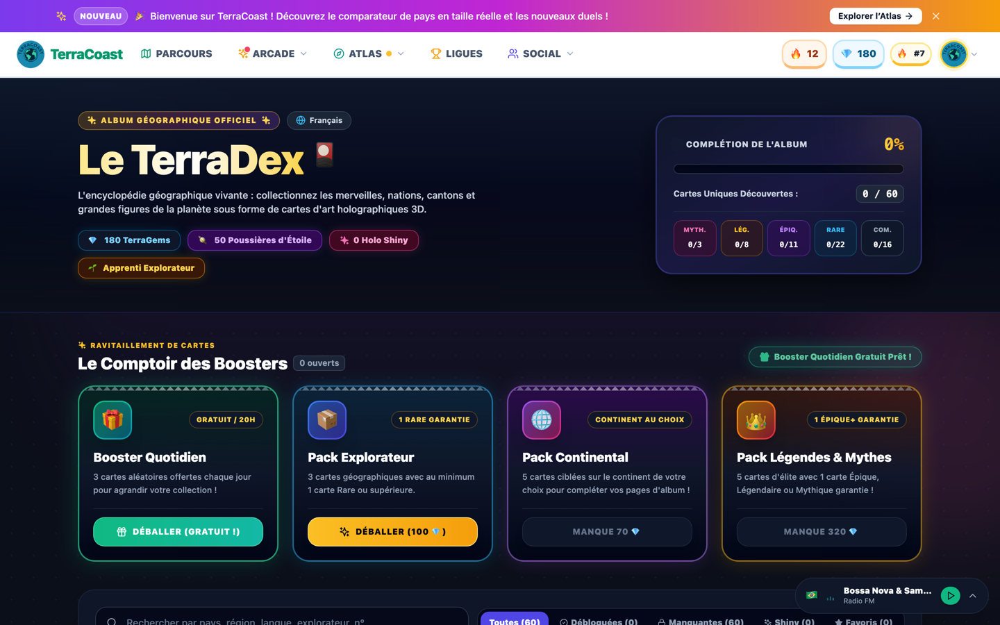

---

### ⚔️ 8. Arène de Duels 1v1 & Matchmaking
> *Affrontez des joueurs en direct en mode Classé (ELO/MMR) ou Amical, avec radar de recherche, défis entre amis et Ghost Runs asynchrones.*

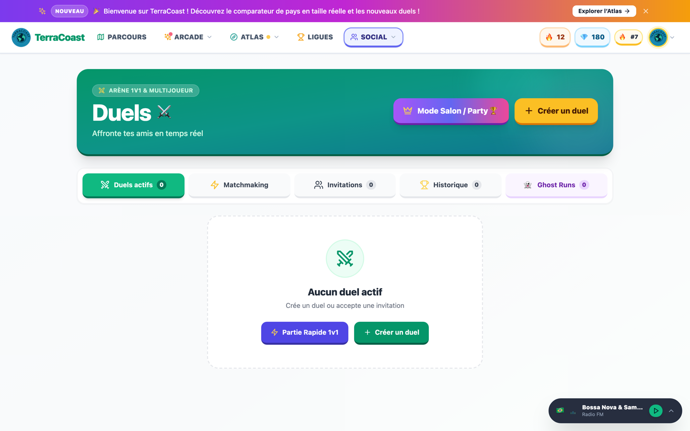

---

### 👑 9. Salon Multijoueur Party (Style Kahoot)
> *Défiez jusqu'à 10 amis simultanément depuis leur smartphone ou PC avec un code PIN à 6 chiffres, avatars de fête et podium animé en direct.*

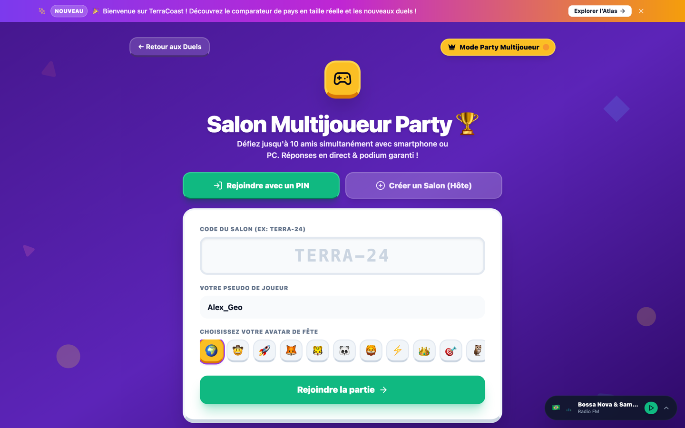

---

### 🏆 10. Ligues Hebdomadaires & Compétition
> *Divisions compétitives (Bronze, Argent, Or, Saphir, Rubis, Diamant), zone de promotion et coffres de gemmes & boosters chaque dimanche à minuit.*

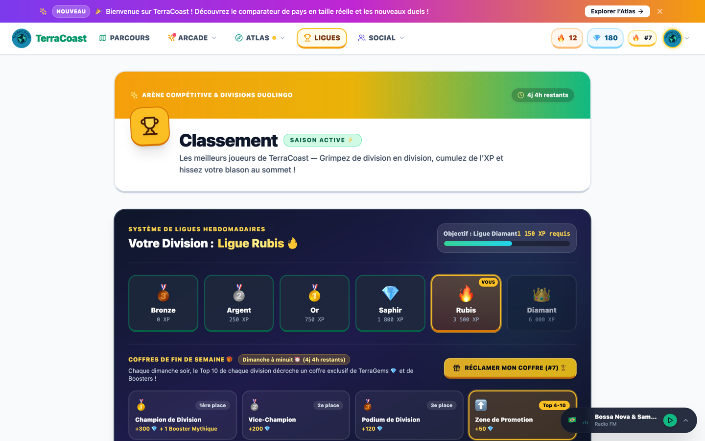

---

### 🛍️ 11. Boutique de l'Explorateur
> *Gels de Flamme 🧊 pour protéger vos séries, cadres d'avatar exclusifs, thèmes de globe 3D et titres honorifiques.*

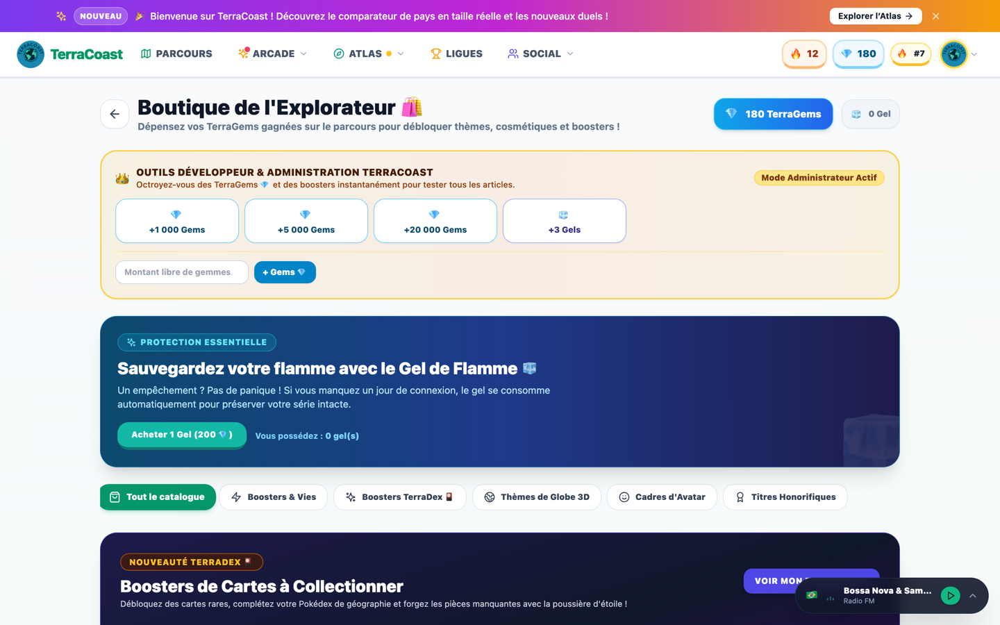

---

### 🛡️ 12. Console d'Administration Globale (v2.4)
> *18 modules de pilotage : intelligence géo (250 pays), spotlight pays, gestionnaire GeoGuessr photos satellites, cartes TerraDex et réglages en direct.*

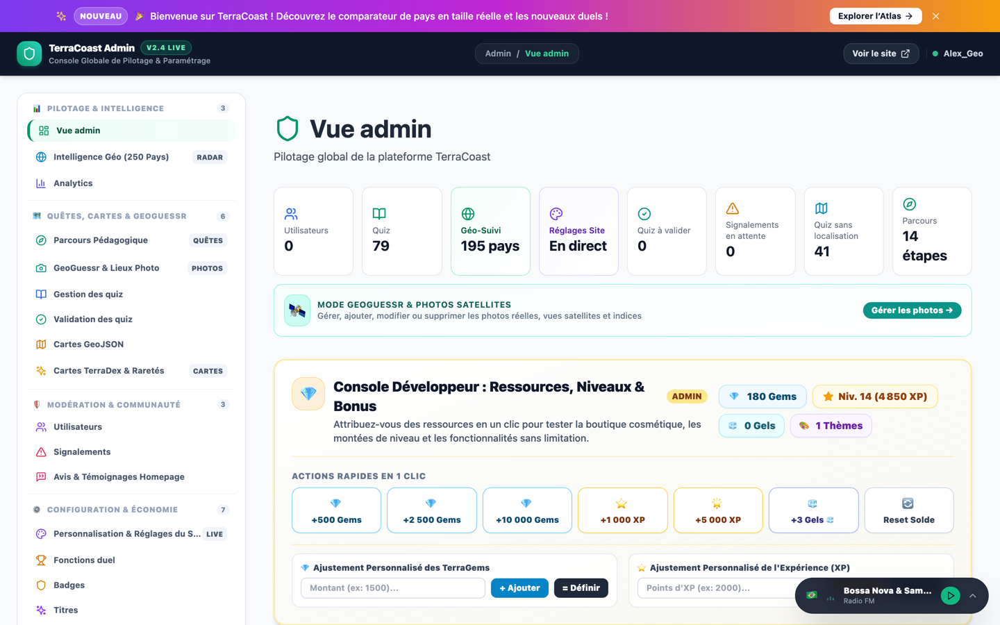

---

## 🔗 Liens Utiles

- 🌐 **Site officiel (Production)** : [https://TerraCoast.ch](https://TerraCoast.ch)
- 🧪 **Environnement de test (Staging / Dev)** : [https://dev.terracoast.ch](https://dev.terracoast.ch)
- 📚 **Documentation technique exhaustive** : voir le dossier [`docs/`](./docs/README.md)
- 📝 **Journal de bord & parcours des fonctionnalités** : [`walkthrough.md`](./walkthrough.md)

---

## 🎯 Fonctionnalités Clés en Détail

### 🧠 1. Quiz & Parcours d'Apprentissage
- **Arbre Pédagogique (Quêtes)** : Progression pas à pas avec déblocage de nœuds, révision immédiate des erreurs et étoiles de maîtrise.
- **Éditeur de Quiz Visuel** : Support d'images HD, questions QCM, Vrai/Faux, texte libre, puzzles sur carte et classements Top 10.
- **Répétition Espacée (SRS / Leitner)** : Système de flashcards 3D en 5 boîtes pour l'ancrage mémoriel à long terme.
- **Mode Zen** : Entraînement sans chrono ni stress pour consolider les acquis.

### 🌟 2. Pokédex Géographique & Conquête Mondiale (`/conquest`)
- **Brouillard de Guerre Interactif (*Fog of War*)** : Le globe débute dans la pénombre ; chaque pays conquis s'illumine en vert émeraude sur le planisphère vectoriel.
- **Validation Automatique** : Conquête validée dès qu'un score ≥ 80% est obtenu en quiz, défi du jour ou duel.
- **Cartes TCG Holographiques** : 250 territoires avec 4 niveaux de rareté (🌟 Légendaire, 🏛️ Épique, 🏰 Rare, 📍 Commune), monument emblématique, capsule culturelle et certificat d'explorateur.

### 🎮 3. Hub des 11 Modes de Jeux Arcade (`/games`)
1. **Geo-Detective Satellite** : Identification de lieux et merveilles mondiales à partir de photos satellites HD et mini-carte zoomable haute précision.
2. **Mode Travle** : Reliez deux pays frontière par frontière avec le moins de détours possible (algorithme BFS).
3. **Silhouette Mystère** : Devinez le pays d'après sa forme vectorielle avec calcul de distance kilométrique et orientation boussole.
4. **Plus Grand / Plus Petit (Higher or Lower)** : Duel infini comparant les populations ou superficies de deux pays.
5. **Chrono Rush** : Survie contre la montre de 45 secondes avec combos de multiplicateurs.
6. **Map Blitz** : Course d'identification éclair de pays sur carte interactive.
7. **Physical Geo** : Reconnaissance des reliefs, fleuves, montagnes et déserts.
8. **Border Puzzle** : Reconstitution de cartes vectorielles, frontières et enclaves.
9. **TimeGuessr** : Défi historico-géographique associant époque temporelle et localisation de photos d'archives.
10. **City Guesser** : Repérage des grandes métropoles mondiales avec calcul kilométrique.
11. **Radio Globe 3D (`/radio-globe`)** : Écoute en streaming de milliers de stations webradio mondiales géolocalisées (*Radio Browser API*).
- **Missions Quotidiennes** : Objectifs renouvelés chaque jour avec distribution sécurisée d'XP et de TerraGems via la RPC atomique `grant_arcade_rewards`.

### 🎴 4. Le TerraDex & Boosters Holographiques (`/cards`)
- **60 Cartes d'Art Collector** : Nations, merveilles naturelles, cantons suisses et grandes figures de l'exploration réparties en 5 raretés (`Commune`, `Rare`, `Épique`, `Légendaire`, `Mythique`).
- **Comptoir des Boosters** : Booster Quotidien gratuit toutes les 20h, Pack Explorateur, Pack Continental et Pack Légendes & Mythes.
- **Effets Holo & Shiny Rares** : Modèle 3D gyroscopique avec reflets métalliques dynamiques et animations d'ouverture de paquets.
- **Forge & Poussières d'Étoile** : Recyclage des doublons pour concevoir directement les cartes manquantes.

### ⚔️ 5. Duels 1v1 & Matchmaking Radar (`/duels`)
- **Matchmaking Temps Réel** : Radar de recherche intelligent par niveau ou catégorie.
- **Mode Classé 🏆** : Calcul d'ELO/MMR instantané et classement des duellistes.
- **Interface Tactile Tour par Tour** : Statuts clairs (*"À toi de jouer !"* vs *"En attente de l'adversaire"*).
- **Ghost Runs 👻** : Défis asynchrones partageables par lien direct ou QR code.

### 👑 6. Mode Salon / Party Multijoueur (`/party`)
- **Expérience style Kahoot** : L'hôte crée un salon avec code PIN à 6 chiffres et QR code instantané.
- **Écran Grand Format** : L'hôte peut diffuser l'écran de jeu sur rétroprojecteur ou TV sans jouer.
- **Synchronisation Realtime** : Questions en direct, choix d'avatars de fête, podium animé, confettis et mode Battle Royale.

### 🗺️ 7. Atlas Mondial Interactif & TrueSize (`/atlas`)
- **Carte 2D Vectorielle & Globe 3D** : Données officielles ONU / Banque Mondiale 2023.
- **4 Calques Graphiques** : Satellite HD, Politique, Reliefs topographiques et Nuit urbaine.
- **Comparateur TrueSize Overlay** : Superposition dynamique pour apprécier la taille réelle des pays sans la déformation de Mercator.
- **Micro-États Cliquables** : Pastilles d'accentuation pour Monaco, le Vatican, Saint-Marin, Nauru, Singapour, etc.

### 🏆 8. Gamification, Flamme & Boutique (`/shop`, `/leaderboard`)
- **Apprentissage Sans Sanction** : Zéro système restrictif de cœurs ou de vies pour s'entraîner sans barrière punitive.
- **Séries Quotidiennes (Flamme 🔥)** avec calendrier hebdomadaire, multiplicateurs d'XP et Gels de Flamme 🧊.
- **Ligues Hebdomadaires** : 6 divisions (Bronze à Diamant), podium dominical et coffres de boosters.
- **Boutique Personnalisée** : Cadres d'avatar animés, thèmes de globe 3D et titres de profil.

### 🛡️ 9. Console d'Administration v2.4 (`/admin`)
- **18 Modules de Contrôle** classés en 4 pôles : Pilotage & Intelligence, Quêtes & Jeux, Modération & Communauté, Configuration & Économie.
- **Intelligence Géo (250 Pays)** : Vue radar et sélection en 1 clic du *Pays de la Semaine* (Japon, bonus XP +50%, capsule culturelle vocale TTS).
- **Gestionnaire GeoGuessr Photos** : Téléversement, géolocalisation GPS et validation des clichés satellites.
- **Studio TerraDex** : Création, équilibrage des raretés et synchronisation directe Supabase.
- **Configuration Globale en Direct (`site_config`)** : Annonces mondiales, week-ends Double XP et mode maintenance en temps réel.
- **Audit & Sécurité** : Traçabilité des actions sensibles via la fonction RPC `log_admin_event`.

---

## 📊 Provenance & Utilisation des Données (Data Lineage)

| Type de Donnée | Source & Origine | Fichier Source Clé | Utilisations Principales |
|---|---|---|---|
| **Démographie & Géographie** | ONU (UNSD), Banque Mondiale 2023, GeoNames, REST Countries | [`atlasData.ts`](file:///Users/fullann/Documents/GitHub/TerraCoast/src/lib/atlasData.ts) | Atlas 2D/3D, fiches pays, comparateur TrueSize, Higher/Lower |
| **Vecteurs & Frontières** | Natural Earth 110m & 50m, TopoJSON, SwissTopo | `ne_50m_admin_0_countries.json`, `world-atlas` | Cartes interactives, Conquête Pokédex, puzzles cartographiques, Travle |
| **Monuments & Anecdotes** | UNESCO World Heritage, encyclopédies vérifiées | [`conquestManager.ts`](file:///Users/fullann/Documents/GitHub/TerraCoast/src/lib/conquestManager.ts) | Cartes holographiques du Pokédex (`/conquest`) |
| **Photos & Coordonnées** | Unsplash (licence libre), Wikimedia Commons, Admin | [`geoDetectiveLocationsManager.ts`](file:///Users/fullann/Documents/GitHub/TerraCoast/src/lib/geoDetectiveLocationsManager.ts) | Jeu Geo Detective (`/games/geo-detective`) & Panneau Admin |
| **Stations Radios Mondiales**| *Radio Browser API* (annuaire mondial communautaire) | [`radioGlobe.ts`](file:///Users/fullann/Documents/GitHub/TerraCoast/src/lib/radioGlobe.ts) | Radio Globe 3D (`/radio-globe`) & streaming audio |
| **Comptes & Gamification** | Base de données PostgreSQL Supabase (RLS, RPC) | Table `profiles`, [`gamificationManager.ts`](file:///Users/fullann/Documents/GitHub/TerraCoast/src/lib/gamificationManager.ts) | Profil, XP, niveaux, flamme, ligues, duels, salons party, TerraDex |

> 📖 Pour la matrice exhaustive de l'ensemble des données, consultez le guide dédié : [`docs/16-data-sources-and-usage.md`](./docs/16-data-sources-and-usage.md).

---

## 🏗️ Architecture & Technologies

| Domaine | Technologies |
|---|---|
| **Frontend** | React 18, TypeScript, Vite, TailwindCSS (Design tactile Duolingo & animations Framer Motion) |
| **Routage** | `react-router-dom` v7 avec découpage dynamique (`lazyWithRetry`) et suspense granulaire |
| **Backend & Données** | Supabase (PostgreSQL, Row Level Security, Triggers SQL, RPC atomiques) |
| **Temps Réel** | Supabase Realtime Channels (Broadcast + Presence pour le mode Party & Duels) |
| **Cartographie 2D & 3D** | `react-simple-maps`, `world-atlas`, `react-globe.gl`, `three`, TopoJSON, Natural Earth 50m |
| **Audio & Effets** | Synthétiseur Web Audio API natif (`soundManager.ts`) + Canvas Confetti |
| **Graphiques** | `recharts` |
| **Tests & Qualité** | Vitest (41 suites de tests, 276 tests unitaires passés avec succès), ESLint 9 |
| **Sécurité & CI/CD** | GitHub Actions, scan Gitleaks secret detection, audit de dépendances `npm audit` |

---

## 📁 Structure du Projet

```text
TerraCoast/
├── docs/                     # Documentation technique & guides d'architecture
│   ├── screenshots/          # Captures d'écran HD de l'application
│   ├── 01-overview.md        # Présentation globale
│   ├── 02-architecture.md    # Schéma d'architecture technique
│   ├── 04-security-rls.md    # Sécurité & politiques RLS Supabase
│   ├── 08-gameplay.md        # Logique des 11 modes de jeu
│   ├── 10-admin-dashboard.md # Panneau d'administration
│   └── 16-data-sources.md    # Matrice de lignage des données
├── public/                   # Actifs publics statiques, logos, sons, manifest PWA
├── src/
│   ├── components/
│   │   ├── admin/            # Hub admin, analytics, validation, config site, photos
│   │   ├── atlas/            # Carte 2D, globe 3D, fiches pays, comparateur TrueSize
│   │   ├── audio/            # Radio Globe 3D et lecteur de stations webradio mondiales
│   │   ├── auth/             # Connexion, inscription, garde de routes (AuthLayout)
│   │   ├── cards/            # TerraDex & Comptoir des Boosters holographiques
│   │   ├── common/           # Avatar, modales, toasts, confettis, badges
│   │   ├── conquest/         # Pokédex Géographique & Conquête (fog of war)
│   │   ├── daily/            # Quiz du jour & missions quotidiennes
│   │   ├── duels/            # Duels 1v1, matchmaking radar, Ghost Runs
│   │   ├── friends/          # Liste d'amis, demandes d'amitié, chat
│   │   ├── games/            # Hub des 11 modes de jeu (Geo Detective, Travle, etc.)
│   │   ├── home/             # Accueil, parcours de quêtes et progression
│   │   ├── landing/          # Page de présentation publique & vitrine 2.0
│   │   ├── layout/           # Barre de navigation responsive, bannières d'annonces
│   │   ├── leaderboard/      # Ligues compétitives hebdomadaires (Bronze à Diamant)
│   │   ├── party/            # Salon multijoueur Kahoot-like (lobby, live game, podium)
│   │   ├── profile/          # Profil joueur, paramètres, gestion de la flamme
│   │   ├── quizzes/          # Éditeur de quiz, catalogue, moteur de jeu multi-modes
│   │   └── shop/             # Boutique cosmétique (gels, cadres, thèmes de globe)
│   ├── contexts/             # AuthContext, LanguageContext, NotificationContext, RadioGlobeContext
│   ├── i18n/                 # Système multilingue (FR, EN, DE, ES, IT, PT)
│   ├── lib/                  # Client Supabase, gestionnaires métier, algorithmes de jeu (BFS Travle)
│   └── supabase/             # Migrations SQL, schémas, politiques RLS et fonctions RPC
```

---

## 🚀 Démarrage Rapide

### Prérequis
- Node.js (version 18 ou supérieure, recommandé v22)
- npm ou yarn

### Installation
```bash
git clone https://github.com/Fullann/TerraCoast.git
cd TerraCoast
npm install
```

### Configuration (.env)
Créez un fichier `.env` à la racine :
```env
VITE_SUPABASE_URL=https://ton-projet.supabase.co
VITE_SUPABASE_ANON_KEY=ta-cle-publique-anon
```

### Lancement du Serveur de Développement
```bash
npm run dev
```
L'application est disponible localement sur [http://localhost:5173](http://localhost:5173).

### Scripts Utiles
- **Exécuter les tests unitaires** : `npm test`
- **Vérifier les types TypeScript** : `npm run typecheck`
- **Compiler pour la production** : `npm run build`
- **Linter le code** : `npm run lint`

---

## 👥 Auteurs & Remerciements

- **[Fullann]** – Conception de la plateforme et développement
- **[Biscome]** – Passionné de géographie & retours produit
- La communauté des passionnés de géographie, d'exploration et de cartographie !
